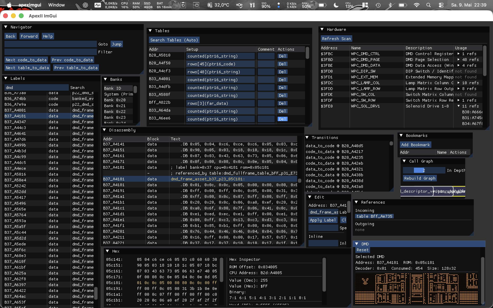
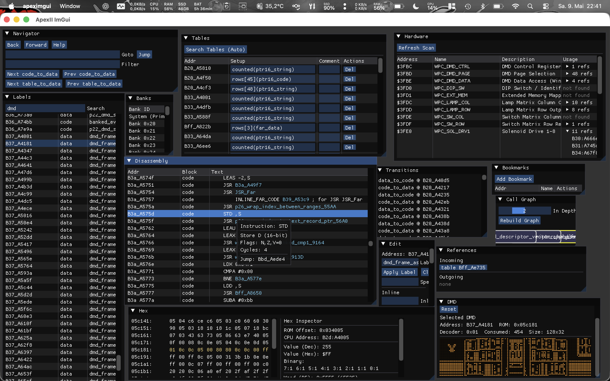
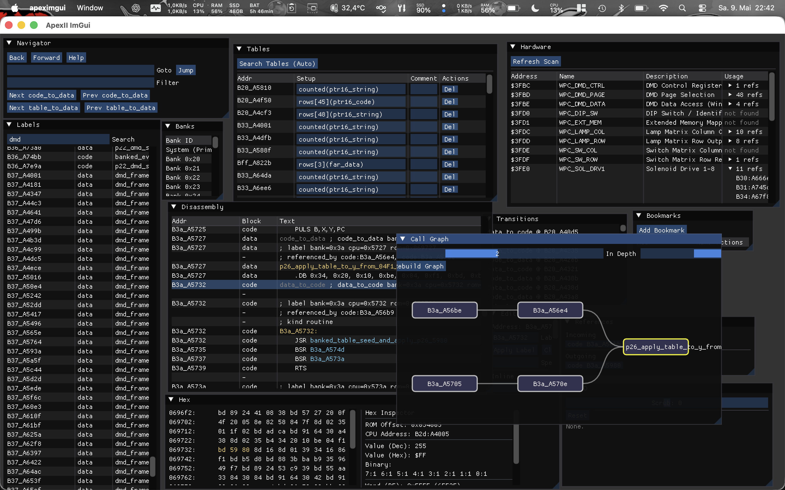
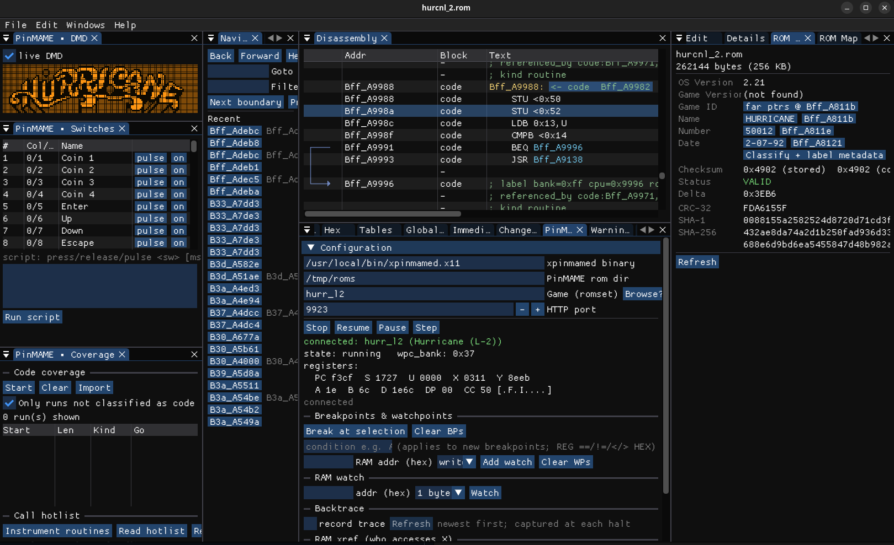

<p align="center">
  
</p>

# ApexII

ApexII is a reverse engineering toolchain for Williams WPC (WPC/WPC-S/WPC95) with 6809 CPUs

It currently contains the desktop UI [`apeximgui`](#apeximgui) and the following command-line tools:

- `apexdis`: ROM -> assembly disassembler
- `apexasm`: assembly -> ROM assembler
- `apextab`: heuristic helper for finding likely text and far-pointer tables
- `apexini`: config file utilities (syntax check, overlap detection, merge, normalize, coverage, inline-routine detection) and ROM insight reports (game hooks, typed arguments, lamp / flag bit map, routine cards, adjustment / audit names, PinMAME nvram-maps export / import)
- `apexmatch`: transfers labels and inline signatures from an analysed ROM to a different ROM version by fingerprint matching
- `apexcompare`: compares two ROM versions and reports routines/strings/tables as identical, moved, changed, removed or added
- `apexmeta`: displays ROM metadata (OS version, game version, checksum, hashes) and can fix or disable the hardware checksum
- `apexdmd`: decodes WPC DMD (dot-matrix display) full-frame images to PBM/PGM, including whole frame tables
- `apexpatch`: builds patched ROMs from a `.patch.ini` (code, strings, values, tables, DMD frames, sprites; `expect` guards, automatic reference fixups, free-space allocation), with diff, report, IPS / BPS export and rebasing onto other ROM versions

The project is optimized for reversible work:

1. disassemble a ROM
2. improve ROM-specific metadata in a config file
3. assemble the generated source again
4. verify byte-identical roundtrip output

## Build And Test

```sh
make
make test
```

Linux is the primary development platform and the default build path.

If you only need the command-line tools, you can build just those with:

```sh
make apexcli
```

Build products:

- `build/apexdis`
- `build/apexasm`
- `build/apeximgui`
- `build/apextab`
- `build/apexini`
- `build/apexmatch`
- `build/apexcompare`
- `build/apexmeta`
- `build/apexdmd`
- `build/apexpatch`

### Dependencies

For the full build including `apeximgui` you need:

- a C compiler
- a C++ compiler
- `make`
- `pkg-config`
- SDL2 development headers and libraries
- OpenGL development headers and libraries

The CLI tools do not depend on SDL2/OpenGL.

### Linux

The current `Makefile` is aimed at Linux first.

Typical requirements:

- `gcc`
- `g++`
- `make`
- `pkg-config`
- `libsdl2-dev`
- OpenGL development package (`libgl-dev` or distro equivalent)

Then:

```sh
make
make test
```

### Windows

Use **MSYS2 MinGW-w64**. The project is not currently set up for a direct MSVC / Visual Studio build.

Recommended environment:

- MSYS2 `UCRT64` or `MINGW64` shell
- `make`
- `gcc`
- `g++`
- `pkg-config` / `pkgconf`
- `git`
- `SDL2`

Typical MSYS2 package set:

- `base-devel`
- `mingw-w64-ucrt-x86_64-toolchain` or `mingw-w64-x86_64-toolchain`
- `mingw-w64-ucrt-x86_64-pkgconf` or `mingw-w64-x86_64-pkgconf`
- `mingw-w64-ucrt-x86_64-SDL2` or `mingw-w64-x86_64-SDL2`
- `git`

Notes:

- `apeximgui` links OpenGL as `-lopengl32` on Windows.
- `make test` expects a POSIX shell environment and tools such as `sh`, `cmp`, `grep`, `sed`, `od`, and `wc`, so run it from the MSYS2 shell, not plain `cmd.exe`.

### macOS

Use Apple Clang plus Homebrew-installed libraries.

Requirements:

- Xcode Command Line Tools
- `make`
- `pkg-config`
- `sdl2`

Typical setup:

```sh
xcode-select --install
brew install pkg-config sdl2
make
make test
```

Notes:

- `apeximgui` links against `-framework OpenGL` on macOS.
- OpenGL is deprecated on macOS, but it is sufficient for the current ImGui frontend.
- The CLI test suite uses standard Unix command-line tools that are available on macOS by default.

## Tool Overview

### `apeximgui`

`apeximgui` is the native desktop UI built on [Dear ImGui](https://github.com/ocornut/imgui). It provides interactive disassembly, inline editing, and cross-reference navigation on top of the same analysis engine used by the CLI tools.

**Launch:**

```sh
build/apeximgui <rom> [config.ini]   # open ROM with optional config
build/apeximgui <rom> [config.ini] --patch FILE   # ... and open a patch file
build/apeximgui                      # open ROM/INI file pickers at startup
```

When started without arguments (and no saved session), a file picker appears automatically — first to select the ROM, then optionally to select a config INI.

**File menu:**

| Item | Description |
|---|---|
| Save Overlay (`Ctrl+S`) | Write accumulated edits to `<config>.apeximgui.ini` |
| Save INI As… | Export the full merged config (base + all edits) to a new `.ini` file |
| Consolidate into Base INI | Merge overlay into the base INI and reset the overlay to empty |
| Re-analyze (`F5`) | Re-run analysis without clearing cached results |
| Force Full Re-analyze (`Shift+F5`) | Flush analysis cache and re-run from scratch |
| Import / Export RAM Map (JSON)… | PinMAME nvram-maps JSON into / out of `[symbols]` / `[docs]` (see below) |
| Exit | Quit (asks about unsaved edits) |

**Edit menu:** Undo / Redo of analysis edits (`Ctrl+Z` / `Ctrl+Y`). **Windows menu** also has Zoom In / Out / Reset. **Patch menu:** the Patch window, the patched-ROM view and *Test in PinMAME*. **Help:** the keyboard shortcuts (editable, see below).

**Windows menu:** All panels can be shown or hidden individually; visibility is kept per ROM in the session, positions and docking in `imgui.ini`. The layout can be reset to the default via Windows → Reset Layout. A panel added in a newer version, unknown to an existing `imgui.ini`, opens docked in its default area instead of floating.

**Sorting:** the data/list tables (Labels, Tables, Symbols, Inline Sigs, Code Entries, Strings, Ref Exclusions, RAM References, Code Candidates, Inline Detection, Sprites, ROM Compare, Coverage, Search, Bookmarks, DMD Frames) are click-to-sort: click a column header to cycle ascending → descending → unsorted; the arrow shows the current direction.

**Key panels:**

- **Disassembly** — scrollable listing with inline syntax highlighting and clickable label links
- **Navigator** — back / forward history, Goto (label or address) and a filter
- **Global Search** — search labels, docs, strings and code text across the project
- **Transitions / Flow Arrows** — block boundaries of the listing / branch arrows in the margin (a toggle)
- **Details** — the selected line: address, block, origin, targets
- **Call Graph** — callers and callees of the routine at the cursor, to a chosen depth
- **Hardware** — the WPC hardware registers and what the code does with them
- **Tables / Strings** — every configured table / every string, sortable, click to jump
- **Types** — edit the `[types]` enums (and name adjustments from the ROM, see [Adjustment and audit names](#adjustment-and-audit-names))
- **Pattern Search** — find a byte pattern (`BD ?? 7E`, `??` = any byte)
- **RAM References** — every instruction that accesses a RAM address
- **Immediate Loads** — `LDX` / `LDD` / ... `#imm16` loads; jump to or label the target
- **Change Log** — every edit of this session; click to jump
- **Ref Exclusions** — addresses whose immediate is not a reference
- **Code Candidates** — unanalysed bytes that look like code (far-pointer and probe tiers); scan and accept
- **Inline Detection (prime bank)** — inline-argument routines of the system bank (see `apexini detect-inline`)
- **Warnings / Flow Breaks** — disassembly warnings / code that runs into non-code (a wrong classification or inline signature); click to jump
- **DMD Frames / Sprites / Sprite Gallery / DMD Preview** — the images of the ROM, browsable, with export
- **PinMAME (dynamic) / · DMD / · Switches / · Coverage** — the running emulator: control, breakpoints / watchpoints, RAM, the live DMD, switches, coverage (see [PinMAME dynamic analysis](#pinmame-dynamic-analysis-optional))
- **Labels / Banks / Bookmarks** — navigation panels
- **Edit** — set labels, classify bytes (code/data/string/table/inline), add docs
- **References** — incoming and outgoing cross-references for the selected address
- **Hex** — raw byte view, synced to disassembly selection
- **Inline Sigs / Code Entries** — bulk-edit inline signatures and code entry points
- **Symbols** — named RAM/hardware address definitions
- **ROM Map** — visual bank/block overview
- **Coverage** — per-kind classification percentages (code/data/table/sprite/unclassified/unknown/free) plus a worklist of unclassified gaps with click-to-jump and "jump to next gap"
- **Argument Values** — typed argument values grouped by type and value with every call site: registers declared with `@args A:TYPE` in a routine doc (traced to their immediate load, which then renders as the enum equate) and named-type `[inline]` fields; name a value or declare `@args` for the routine under the cursor (see [`[docs]`](docs/config-format.md#docs))
- **Patch** — edit a `.patch.ini` (see [`apexpatch`](#apexpatch)) against the open ROM: right-click an instruction → **Patch** to NOP it out, invert / force / suppress a branch, change a call or jump target, replace it with assembler code or edit its bytes (the new op gets its `expect` guard from the original bytes); the window lists the ops with their build status, edits the selected one with a live original-vs-new view, marks patched bytes magenta in the disassembly, switches the disassembly between the original and the **patched ROM** (the patch's labels and new code blocks join the analysis there, without entering the config), adds ops of every type (**Add op**), shows the free space per bank, hooks an instruction (right-click → Patch → *Hook here*), edits strings and values and moves tables / data (right-click a data line → Patch), lists the references a data op rewrites (click to jump), builds the patched ROM and **tests it in PinMAME** (the patched game ROM goes into `pinmame/<game>/` next to the patch file, in front of the original rom path, so the sound ROMs still come from the original zip). The open patch is remembered per ROM.
- **Game Hooks** — the WPC game-hook table (see [Game-hook table](#game-hook-table)): every OS→game far-call slot with its target, the OS routine that calls it, a slot-label editor and — with PinMAME coverage — whether the hook ran (or is new since the coverage baseline)
- **Bit Map** — the lamp / flag bit map (see [Bit map](#bit-map)): per matrix and bit, how often the code turns it on, off or tests it; select a bit for its call sites (click to jump), name it, or pick a `[types]` type that names a whole matrix
- **Routine Card** — the routine at the cursor (or a pinned one) at a glance: extent, callers, calls (far calls resolved), bits it sets / clears / tests, RAM it reads and writes, data and strings it refers to, whether it ran in PinMAME, and name suggestions from those (strings, flag names, RAM symbols) with a rename field; *watch* adds it to the Event Timeline
- **Event Timeline** — records a running PinMAME game: switch changes, lamp / flag operations (tracepoints on the bit routines; bit tests optional) and calls of watched routines (with A, B, X), in time order, as lanes and a filterable list; click a bit event for its code in the Bit Map, a routine call to jump to it; per-matrix display filters hide e.g. the attract lamp show
- **ROM Info** — OS version, game version string, checksum status, CRC-32/SHA-1/SHA-256 hashes (read-only; hashes computed lazily on first open)
- **Match from Reference** — GUI front-end for `apexmatch` (see below)
- **ROM Compare** — GUI front-end for `apexcompare`: diff two ROM versions into a filterable table (identical/moved/changed/removed/added) with a Top-3 candidate sidebar for the selected routine

Opened from elsewhere: **Insert Snippet** and **Rebase Result** (Patch window), **Import RAM Map** (File menu), **Keyboard Shortcuts** (Help).

**Keyboard shortcuts (selected):**

| Key | Action |
|---|---|
| `J` / `K` | Move selection down / up |
| `N` / `P` | Next / prev block boundary |
| `F` / `Enter` | Follow link / jump to target |
| `[` / `]` | History back / forward |
| `G` | Go to address |
| `L` | Edit label |
| `C` | Mark as code |
| `D` | Mark as data |
| `Ctrl+S` | Save overlay |
| `F5` | Re-analyze |

All shortcuts are configurable in **Help → Keyboard Shortcuts** (default `H`): click a binding and press the new key with its modifiers; each action takes two bindings, conflicts are marked, and changed bindings are stored in `imgui.ini` (`[ApexII][Keys]`, only those differing from the defaults). A binding matches only with exactly its modifiers.

**Match from Reference panel (Windows → Match from Reference):**

Transfers labels and inline signatures from an already-annotated reference ROM to the currently open ROM using the same fingerprint engine as `apexmatch`:

1. Open the panel, enter (or Browse for) the reference ROM and its config INI.
2. Click **Run Match**. With **System scan** enabled the scan phase runs automatically.
3. Results appear sorted by confidence tier — Exact (L1+L2, ≥90%), High (L1+callees, ≥75%), Medium (L1 only, ≥55%).
4. Click **Accept All Exact** to apply all exact matches in one step. The disassembly updates immediately.
5. Review High/Medium matches individually — click the address button to jump to the target location, then **Accept** to apply.

Accepted matches write labels, code entries, inline signatures, and routine docs to the active overlay. The panel stays open so results can be accepted incrementally.

#### PinMAME dynamic analysis (optional)

`apeximgui` can drive a running game for **dynamic** analysis by spawning a headless [PinMAME](https://github.com/vpinball/pinmame) and talking to its remote-debugger HTTP API. It is entirely optional — nothing runs until you configure and launch it, and the CLI tools are unaffected.

**Requirements:** a PinMAME build with the remote debugger enabled (`REMOTE_DEBUG = 1` in `makefile.unix`, producing an `xpinmamed.*` binary that supports `-headless`), plus your PinMAME roms (e.g. `~/.pinmame/hurr_l2.zip`).

**Setup:** in the **PinMAME (dynamic)** window (Windows menu) set the `xpinmamed` binary path, the PinMAME rom directory (or pick the `.zip` via Browse — it fills in the rom set), and the HTTP port, then **Launch**. Config persists in the session.

The panel is split into four dockable windows so live views can sit side by side:

- **PinMAME (dynamic)** — launch/exec control (resume/pause/step, step over/out, run to selection, machine reset); live status with the full 6809 register set (frozen at a halt, CC flags decoded); breakpoints & watchpoints (bank-aware, also settable from the disassembly right-click menu; breakpoints optionally conditional, e.g. `A==7F`, and with an ignore count; watchpoints optionally with a value condition, e.g. "write == 05"), each switchable on/off; an SSE halt banner reporting **which** breakpoint/watchpoint fired (and, for a watchpoint, the accessed address); the emulator's **call stack** (caller → callee per frame); an execution backtrace; a live **RAM watch** resolved to NVRAM symbols; a **dynamic RAM xref** ("who accesses X" — logs the reading/writing code sites through the emulator's memory access trace while the game keeps running, with the last written value on newer emulators); and a **computed-jump resolver** that steps an indexed `JMP`/`JSR` to enumerate its real targets.
- **PinMAME · DMD** — the live dot-matrix display.
- **PinMAME · Switches** — the switch matrix (with col/row) with per-switch on/off/pulse, plus a mini-script (`press`/`release`/`pulse`/`wait`/`resume`/`pause`) to drive inputs and reach a target state.
- **PinMAME · Coverage** — import execution **coverage** (overlay executed/never-executed code in the disassembly, plus a "missed code" worklist) and a **call hotlist** (per-routine execution counts, sortable). **Differential coverage:** *Set baseline from import* stores one import (e.g. ball in play, nothing hit); after *Clear*, triggering a feature (switch mini-script) and importing again, *new since baseline* lists only the routines that ran for the feature (and tints them amber in the disassembly), *no longer executed* the reverse. The hotlist has the same idea: *Set baseline* snapshots the counters, the *Delta* column then shows the calls since, optionally only routines never called at baseline.

All polling, halt handling, collection loops and scripts run once per frame from the app's main loop, so the live views keep updating even when a PinMAME window is on a background tab.

#### Screenshots


*Figure 1: Main Disassembly, Navigator, Labels, DMD View*


*Figure 2: Disassembly with tooltip, shows instruction details


*Figure 3: Call Graph*


*Figure 4: Integrated PinMAME Debugger


### `apexdis`

Usage:

```sh
build/apexdis [--xref] [--explain] [--addr] <input-rom> <output-asm> [config.ini]
```

- `--xref`: list each label's incoming references in a comment
- `--explain`: say why each block was classified as it was
- `--addr`: a `; addr Bxx_Ayyyy` comment before every instruction (turns `instruction_addresses` on for this run)

Examples:

```sh
build/apexdis roms/addam_h4.rom out/addam_h4.asm
build/apexdis --xref roms/addam_h4.rom out/addam_h4.asm tests/addam_inline.ini
build/apexdis --xref --explain roms/addam_h4.rom out/addam_h4.explain.asm tests/addam_inline.ini
```

Flags:

- `--xref`: emit typed `referenced_by` comments and an `XREF INDEX`
- `--explain`: emit classification/provenance comments such as `config_entry`, `config_data`, `code_flow`, `table_ptr16_data_ref`, and so on

The disassembler expects a 256 KiB, 512 KiB or 1 MiB WPC ROM. CPU-visible addresses are used throughout assembly and config files:

- paged ROM window: `0x4000..0x7fff`
- fixed system area: `0x8000..0xffff`

Generated assembly includes:

- `.ROM_SIZE <bytes>`
- `.BANK <index>` or system bank output in the fixed area
- `.ORG <cpu-address>`
- `BANK_ID <byte>` at the start of paged banks
- generated labels like `B20_A4000` or `Bff_A8990`
- comments with logical bank, CPU address, and physical ROM offset
- optional xref and explain comments

### `apexasm`

Usage:

```sh
build/apexasm <output-rom> <input-asm> [input-asm ...]
```

Examples:

```sh
build/apexasm out/addam_h4.rebuilt out/addam_h4.asm
build/apexasm out/patched.rom base.asm patch.asm
```

Later input files may overwrite earlier bytes at the same `.BANK`/`.ORG` address.


### `apexpatch`

Builds a patched ROM from a **patch file** — an ordered list of changes to the original ROM, kept separate from the analysis config so the analysis keeps describing the original.

```sh
build/apexpatch init  <rom> <analysis.ini|-> <game.patch.ini>   # start a patch file (records the ROM's CRC-32)
build/apexpatch check <game.patch.ini>                          # build in memory, report every op
build/apexpatch build <game.patch.ini> [-o out.rom]             # write the patched ROM
build/apexpatch diff  <game.patch.ini>                          # original vs new bytes / code per op
build/apexpatch pin   <game.patch.ini>                          # add missing expect guards, pin allocations
build/apexpatch map   <game.patch.ini>                          # free space per bank, before / after
build/apexpatch report <game.patch.ini> [-o report.md]          # Markdown report of the patch
build/apexpatch export <game.patch.ini> <out.ips|out.bps>       # distributable patch for players
build/apexpatch apply  <rom> <patch.ips|patch.bps> -o out.rom   # apply an IPS / BPS patch
build/apexpatch rebase <game.patch.ini> <other.rom> [other.ini] -o other.patch.ini
build/apexpatch ram    <game.patch.ini> [min] [--sample ramdump.bin ...]  # RAM candidates for ram ops
build/apexpatch snippets [game.patch.ini]                       # list the snippet library
build/apexpatch add <game.patch.ini> <snippet|file.asm> <op name> [at=..] [alloc=..] [NAME=value ...]
```

```ini
[patch]
base_rom   = afm_113b.bin          ; paths are relative to the patch file
base_crc32 = 0x1234abcd            ; a different ROM is refused
analysis   = afm.ini               ; labels for addresses and asm symbols
checksum   = fix                   ; fix | disable (delta 0x00FF) | keep
output     = afm_patched.bin

[op:longer_ballsave]
type   = bytes
at     = BallSave_Start+0x0c       ; label[+/-n], Bxx_Ayyyy[+/-n] or 0x8000-0xffff
expect = 86 0a                     ; original bytes: guard against the wrong ROM
bytes  = 86 14

[op:skip_check]
type  = nop
at    = B38_A4a96
count = 2                          ; instructions (or: length = bytes)

[op:new_logic]
type = asm
at   = B38_A48e3
code =
    | JSR MyRoutine                ; '|' lines are taken verbatim
; or: file = new_logic.asm
```

More op types bring new code and data:

```ini
[op:timer]                          ; a RAM variable for patch code
type  = ram
at    = 0x0100
label = BallSaveTimer               ; length = bytes (default 1)

[op:routine]                        ; new code in free space
type  = asm
alloc = system                      ; same (default: the site's bank, then system) | system | any | bank:NN
code  =
    | MyRoutine:
    |     LDA #0x05
    |     STA BallSaveTimer
    |     RTS
; placed = Bff_A8016                ; written by pin: later builds keep it there

[op:count_checks]                   ; detour: JMP at `at` to the code, the
type = hook                         ; replaced instructions, JMP back
at   = Check
code =
    |     INC BallSaveTimer

[op:vector]                         ; pointer to a label (width 3 = far, 2 = word)
type   = ptr
at     = 0x80c1                     ; e.g. a game-hook slot
target = MyRoutine

[op:always_save]                    ; a conditional branch (Bcc / LBcc)
type = branch
at   = BallSave_Check+0x07
mode = always                       ; always (BRA / LBRA) | never (BRN / LBRN) | invert

[op:my_check]                       ; a jump / call / branch to somewhere else
type   = redirect
at     = Check_Call
target = MyRoutine                  ; a label, also of the patch's code

[op:keep_out]                       ; free / reserve: adjust the free space
type   = reserve
at     = 0x8012
length = 4
```

Data ops change tables, values and texts; when data moves, every known reference to it is rewritten:

```ini
[op:lives]                          ; a typed value (table field, data byte, inline argument)
type  = value
at    = Lives                       ; label+offset of the field
width = 1                           ; 1, 2 or 3 (far: a label)
vtype = TYPE_LIVES                  ; lets `value` use the type's enum names
value = nine                        ; number, enum name, equate or label

[op:greeting]                       ; a string
type = string
at   = Str1
text = HELLO!!                      ; \n \t \a escapes
mode = auto                         ; auto | inplace | shift | relocate

[op:data]                           ; move a table / data block / string
type  = move
at    = DataBlk                     ; size from the analysis (or length = N)
alloc = bank:31                     ; default: stay in the bank
```

Asset ops import files:

```ini
[op:logo]                           ; replace a DMD fullframe with an image
type = dmd
at   = B30_A421b                    ; the frame (its planes from the analysis, or planes = N)
file = logo.png                     ; 128x32 PNG, PBM or PGM
mode = auto                         ; auto | inplace | relocate
; encoding = auto                   ; auto (the smallest of raw / run-length) | raw
; bright = 0                        ; 2 planes: the brighter plane (default 1)

[op:icon]                           ; replace a sprite (VSI image) with an image
type = sprite
at   = SprBall                      ; header type and offsets stay; the image sets the size
file = ball.png
mode = auto                         ; auto | inplace | relocate, as for dmd
; bright = 0                        ; bicolor (0xFE / 0xFF): the brighter plane (default 1)

[op:font]                           ; raw bytes from a file
type  = blob
file  = font.bin
alloc = bank:31                     ; or: at = ... (in place, with expect)
label = MyFont                      ; for patch code and ptr ops
```

- **`dmd`** turns the image into bit-planes (1 plane: pixels of 128+ are lit; 2 planes: four grey levels, level 1 = the dim plane, 2 = the bright one, 3 = both), encodes each plane as raw (type 0x00) or column / row run-length (0x01 / 0x02), whichever is shortest, and writes the frame in place if it is not longer than the old one. Otherwise it goes to free space, the pointers to the frame are rewritten (when all of them are far pointers it may go to any bank), and -- as with `move` -- the old place is cleared to 0xFF and booked as free. PNG (grey, RGB, palette, alpha; not interlaced), PBM (1 = lit, as `apexdmd` writes planes) and PGM are read; `apexdmd`'s exports come back unchanged. In the GUI: right-click a frame's label > *Patch > Replace frame from image...*.
- **`sprite`** does the same for a VSI image: one plane for `0x00` / `0xFD` and no-header images, two (four grey levels, like `dmd`) for the bicolor `0xFF` (both planes inline) and `0xFE` (plane 1 behind a pointer: rewritten there, so the size must stay, and every sprite sharing that plane changes too). A no-header image keeps its table's height. Pixels are stored MSB first. A larger image is relocated and its pointers are rewritten. GUI: *Patch > Replace sprite from image...* on a sprite's label. The op editor shows the image before and after the patch for both `dmd` and `sprite`.
- **`string`**: *inplace* writes a text that fits (the old string must not be pointed into); *shift* moves the strings directly behind it (each one a label) up -- only when the bytes after them are free -- and rewrites the pointers to them; *relocate* puts the text into free space and points the references there; *auto* takes the first that works.
- **`move`** copies the block to free space, rewrites the references (pointers inside the block itself in the copy), clears the old place to 0xFF and books it as free.
- **References** come from the analysis (code operands, table rows, inline arguments): in each referencing instruction / row the old address is looked up as a far (address + bank byte) or 16-bit pointer and rewritten. A 16-bit pointer cannot follow data into another bank (*unreachable*); an address that is not found exactly once needs a *manual* fix. Either fails the op unless `accept = yes`. Computed addresses (base + offset) are not found -- test the result. `apexpatch diff` and the Patch window list every reference with its status.
- For `string` / `move` / `dmd`, `expect` guards the old data (the old string, the block's / frame's first bytes), not the bytes written.
- **Free space** is detected in the original image: 0xFF runs at the end of a bank and runs of 64+ bytes inside one that hold no label or data range (the first 0xFF is kept as a possible terminator; never the system bank's vector area). `free` / `reserve` ops add or remove space; `apexpatch map` lists it per bank before and after the patch. Allocations take the first fitting block in the allowed banks; `pin` records them as `placed = ...`, and a later build fails rather than silently move one whose space is gone.
- **`hook`** replaces whole instructions at `at` (at least the 3 bytes of a `JMP`) with a jump to a detour that runs the op's code, then the replaced instructions, then jumps back. It refuses PC-relative instructions and jump targets inside the replaced bytes. The detour lives in the site's bank or the system bank (`alloc`).
- **`ptr`** writes a far (bank-tagged) or word pointer to any label, including the patch's own -- e.g. to redirect a game-hook slot (the Game Hooks window does that for you: *Redirect to new code (patch)*).
- **`branch`** and **`redirect`** compute their bytes from the ROM at build time (so they survive a rebase, unlike hand-made `bytes`): `redirect` takes JSR / JMP extended, BSR, BRA, LBSR, LBRA and conditional branches, checks that a short branch reaches the target and that a target in another paged bank is not used (not mapped), and warns when the old call target took inline argument bytes the new one must skip as well. The disassembly's *Patch > Branch* and *Change target...* make these ops.
- **`ram`** names RAM for patch code; it is checked against other RAM variables and the analysis' `[symbols]`.
- **`bytes`** replaces bytes; **`nop`** overwrites whole instructions (an inline payload after a call counts with its call) with `NOP`; **`asm`** assembles code in place. Without `length`, an `asm` op replaces its own size rounded up to the next original instruction boundary and pads with `NOP`.
- Code ops must start on an instruction boundary of the analysed code (an error otherwise); outside analysed code (e.g. free space) they only warn.
- Asm code resolves symbols against the analysis labels, `[symbols]` (RAM), the `TYPE_VALUE` enum equates and the labels other `asm` ops define (forward references work). Using a label of another paged bank warns: that bank is not mapped while the code runs.
- Every op is checked: `expect` against the original bytes, overlaps between ops, the end of the bank; ops with errors are skipped and the build fails, so all problems show at once. `enabled = no` skips an op.
- Comments in front of a section are kept when `pin` rewrites the file; `note = ...` documents an op.

**Sharing and versions**

- `export` writes the change as **IPS** or **BPS** (the BPS records the CRC-32 of the original, the result and itself, so `apply` -- or any BPS tool -- refuses the wrong ROM); the WPC checksum fix is part of it. `report` writes a Markdown summary: ROMs and CRCs, the ops, each op's changes and rewritten references, the symbols the patch defines, the free space used. The Patch window has both under *Export...*.
- `rebase` carries a patch over to another version of the ROM. Each op's site is looked up in the target: the same address with the same bytes around it; the same offset in the routine apexmatch pairs with the source routine; the bytes around it found exactly once; the code around it with its 16-bit operands (addresses) masked -- code that moved or calls code that moved; finally the op's original bytes alone (a moved string). The op's original bytes must be there; when only address bytes differ, `expect` takes the target's bytes and the op is marked for review. Ops that are not found stay in the new file switched off (`enabled = no`, with a note); allocations are unpinned; `ram`, `free` and `reserve` ops keep their addresses (check them). Without a target analysis, one is made: the target is analysed from the source's system-bank code labels plus its paged routines (entries and named code labels) located in the target -- at the same place with the same bytes, or moved, by their code with the addresses masked -- and the source's labels that apexmatch then pairs with target routines, in every bank, are written to `<new>.labels.ini` (labels and entries) and used, so the patch code's symbols resolve. GUI: *Export... > Rebase onto another ROM version...* (the new patch goes next to that ROM, `<rom>.ini` is used when present); *Open the target ROM with it* starts a second window on the target ROM with the new patch (`apeximgui ROM [CONFIG] --patch FILE` does the same from the shell).

**Snippets** are reusable patch code: `.asm` files whose header names them and their parameters --

```asm
; snippet: Store a constant in RAM
; type: hook
; about: Writes VALUE to a RAM byte whenever the hooked code runs.
; param: VAR RAM byte (a label or 0xNNNN)
; param: VALUE the byte to store = 0x00
    PSHS CC,A
    LDA #{VALUE}
    STA {VAR}
    PULS CC,A
```

`type:` is `asm` (the default) or `hook`. Inserting one fills in `{NAME}` and makes an ordinary `asm` / `hook` op (`note = snippet ...`), so the patch file never depends on the library. The library is `snippets/` next to the patch file, `$APEX_SNIPPETS`, `./snippets` and the set bundled with ApexII (`snippets/`: count executions, store a constant, always branch, return a fixed value). GUI: *From snippet...* in the Patch window or *Patch > From snippet...* on an instruction.

**Free RAM** for `ram` ops: `apexpatch ram` (and *free RAM* in the Patch window) lists RAM runs that no analysed instruction names (direct / extended operands; 16-bit loads and stores count two bytes), that are not in `[symbols]`, not in the window after a pointer base loaded as an immediate (`LDX #0x0123`: indexed accesses are invisible) and not in the 256 bytes below any `LDS #top`; the patch's own `ram` ops are excluded. That alone is a guess: computed accesses are invisible. RAM snapshots of the running game settle it -- a byte that is ever non-zero is used (WPC clears RAM at boot): `--sample` takes 8 KB dumps, the GUI's *sample PinMAME* reads the RAM twice a second while you play (attract mode alone leaves much untouched). Runs in the upper 2 KB (0x1800-) are listed last and flagged: that is usually the battery-backed area with audits and settings, which are zero until counted.

**In the Patch window** edits can be undone (*Undo* / *Redo*, or Ctrl+Z / Ctrl+Y while the window has focus). *Test in PinMAME* also starts PinMAME's code coverage and puts a read trace on the first byte of every data op's new data (the moved place for relocated data; at most 120 ops). After playing the patched feature, *Check run* adds a column: for code ops how many instructions ran, for data ops (value, string, move, dmd, sprite, blob, ptr) whether the game read the new data -- the tooltip names the reading PCs. A 0 / *not read* means that play never reached the patch. The traces replace those of the PinMAME window's RAM xref.

PinMAME runs a patched ROM from a romset **directory**: copy the romset's files to `<dir>/<game>/`, replace the game ROM with the built one (same file name) and start it with `-rompath <dir>`; the WPC checksum must be valid (`checksum = fix`).

### `apextab`

Usage:

```sh
build/apextab <rom_file>
```

`apextab` is a heuristic scanner that currently looks for:

- likely counted string pointer tables
- likely headerless far-pointer tables that reference those string tables

It prints candidate config lines such as:

```ini
B20_A4007 = counted(ptr16_string)
Bff_A8123 = rows[3](far_data)
```

Treat its output as suggestions, not ground truth.

### `apexini`

Usage:

```sh
build/apexini <command> ...      # apexini help lists them all
```

Commands for working with config files: `check`, `overlaps`, `merge`, `migrate`, `normalize`, `find-redundant`, `strip-redundant`, `coverage`, `orphan-labels`, `check-bounds` (below), and the analysis reports `detect-inline`, `hooks`, `args`, `bits`, `card`, `adjnames`, `nvram-export` / `nvram-import` (sections further down).

#### `check`

```sh
build/apexini check <file.ini> ...
```

Loads each config file and reports any syntax or semantic errors — invalid addresses, bad specs, duplicate label names, unknown section names, and so on. Prints a summary of entry counts on success.

```text
tests/addam_inline.ini: OK  labels=448  entries=0  inline=73  data=0  tables=12  types=0
tests/config_duplicate_label.ini: error: label 'DuplicateName' is defined at more than one address
```

The exit code is 0 if all files are valid, 1 if any file has an error.

#### `overlaps`

```sh
build/apexini overlaps <file.ini>
```

Loads the config (including any `include =` chain) and checks for two classes of problem:

- **Same-address conflicts**: the same address is classified in two different sections, e.g. both `[inline]` and `[entries]`.
- **Range overlaps**: an entry with a known byte length extends into the start of another entry in the same bank. Known lengths are: `inline` signatures (always known), `bytes[N]` data, `far_*` data and fields (3 bytes), `dmd_fullframe` data (512 bytes), and `rows[N](schema)` tables.

```text
conflict: Bff_A8005  [entries] code  vs  [inline] 1 bytes
overlap:  [inline] B3d_A7840 (byte, 4 bytes, ends 0x7843) into [data] B3d_A7842 (bytes[10])
```

Exits with 0 if no problems are found, 1 otherwise.

#### `merge`

```sh
build/apexini merge [--override|-o] <out.ini> <file.ini> ...
```

Loads all input files sequentially into one combined config (a later file overrides an earlier one for the same address, following the same deduplication rules as `load_config`; a name defined at two different addresses aborts the merge unless `--override` lets the later definition win). Writes a clean sorted INI to `<out.ini>`:

- `[types]`, `[schemas]`, `[symbols]` — sorted alphabetically by name
- `[labels]`, `[entries]`, `[inline]`, `[data]`, `[tables]`, `[docs]` — sorted by bank then address

Conflicts that would be rejected during normal loading (e.g. the same label name mapped to two different addresses in two files) are reported as merge errors and the output file is not written.

```sh
build/apexini merge combined.ini base.ini base.ini.apeximgui.ini extra.ini
# merged 3 file(s) into combined.ini
```

#### `migrate`, `normalize`

```sh
build/apexini migrate <file.ini> ...          # upgrade old syntax in place (.bak backup)
build/apexini normalize <file.ini> [out.ini]  # canonical form
```

`migrate` rewrites older syntax to the current format and keeps a `.bak`. `normalize` rewrites a config canonically — fixed section order, sorted entries, sorted enum values, `Bxx_Ayyyy` addresses — in place, or into `out.ini`.

#### `find-redundant`, `strip-redundant`

```sh
build/apexini find-redundant <rom> <file.ini>
build/apexini strip-redundant <rom> <file.ini>
```

List the `[entries]` that code flow reaches anyway (they can go), or remove them in place.

#### `coverage`, `orphan-labels`, `check-bounds`

```sh
build/apexini coverage <rom> <file.ini> [--bank N]
build/apexini orphan-labels <rom> <file.ini>
build/apexini check-bounds <rom> <file.ini>
```

`coverage` reports the ROM classification per bank (code / data / table / unclassified / free / unknown; `--bank N` for one bank, its id or `0xff` for the system bank). `orphan-labels` lists `[labels]` whose address does not appear in the disassembly. `check-bounds` checks that data and table ranges stay inside their bank and the ROM.

#### `migrate`

```sh
build/apexini migrate <file.ini> ...
```

Rewrites each file in-place, replacing the legacy `[routine_docs]` and `[table_docs]` sections with a single `[docs]` section. A `.bak` backup is written before overwriting. Use this to bring older config files up to the current format:

```sh
build/apexini migrate tests/myconfig.ini
# migrated tests/myconfig.ini  (12 doc entries → [docs])
```

#### `nvram-import` / `nvram-export`

Exchange a documented RAM map with the [PinMAME NVRAM-maps](https://github.com/tomlogic/pinmame-nvram-maps) JSON format. A memory-location *descriptor* (any JSON object with a `start` field, at any nesting depth) maps to a `[symbols]` name plus a `[docs]` string at that CPU address; `start` is treated as a CPU address (fileformat v0.7+).

```sh
# JSON RAM map -> config ([symbols] + [docs])
build/apexini nvram-import game.nv.json ram_map.ini [base_addr]

# config RAM symbols/docs (addresses below 0x4000) -> JSON RAM map
build/apexini nvram-export config.ini ram_map.json

# zero-loss: merge names/docs back into the original map, preserving every
# other field (encoding, mask, min/max, values, wpc_rtc, …)
build/apexini nvram-export config.ini ram_map.json original.nv.json
```

`nvram-import` derives each symbol name from the descriptor's `short_label` (falling back to `label`), sanitized to a valid identifier and de-duplicated; the `label` becomes the doc. Pass an optional `base_addr` (added to every `start`) for older maps whose `start` is an `.nv` file offset rather than a CPU address.

`nvram-export` without a template writes a fresh minimal map (name + doc + address). With a **template** (typically the map you imported), it rewrites that map in place — updating only each descriptor's `short_label`/`label` from the config and appending any new locations — so all the fields ApexII does not model (`encoding`, `length`, `mask`, `scale`, `values`, `min`/`max`, `wpc_rtc`, …) survive a round-trip untouched.

#### Inline-argument detection (system bank)

```sh
build/apexini detect-inline <rom> [<file.ini>]                    # report
build/apexini detect-inline <rom> [<file.ini>] --apply out.ini    # write an overlay
      [--min-confidence high|medium|low] [--replace-conflicts]
```

Finds routines in the system ("prime") bank that take inline bytes after the call:

- **Markers:** the WPC OS places `0xCF, 0x73+N` directly before a routine with N inline bytes (`0x74` = 1, `0x75` = 2, …; found from about 0xB200 on).
- **Return-address walk:** a routine that pushes n bytes, loads its return address with `LDX/LDU/LDY n,S`, reads the bytes through it (`,X+` byte, `,X++` word, `PULU`, offset loads) and writes the advanced pointer back (or pops it and returns via `JMP ,X`). The accesses give the byte/word layout; a word followed by a byte that is a valid far pointer at every call becomes `far_code`. This covers the marker-less wrappers at the front of the bank, which come ordered by inline length (1-byte ones first, then 2, 3, …).

Each finding has a confidence (high / medium / low) and a status against the config: **new**, **confirmed** (the configured signature has the same length) or **conflict** (different length; never applied unless `--replace-conflicts`). Where code and marker disagree, the code wins (medium). `LDD` reads are reported as `word`; whether the callee treats them as a word or two bytes is not visible in the wrapper. `--apply` (default: high only) runs detect → apply → re-analyse up to five times (applied signatures make more code reachable) and writes an overlay that `include`s the input config: `[inline]` signatures, `[data] bytes[2]` over each marker and `[entries]` for routines not yet known as code.

In `apeximgui`, **Windows → Inline Detection (prime bank)** lists the same findings with their evidence; **Apply all high (new)** applies them as one undo step, **Apply** / **Replace** handles single rows.

#### Typed argument values

```sh
build/apexini args <rom> <file.ini> [--type NAME]
```

Lists every typed value passed to a routine, grouped by type and value — "where is lamp 0x02 set, which code reads adjustment 0x0b". Sources: registers declared with `@args A:TYPE` in a routine's `[docs]` entry, traced back to their immediate load (see [`[docs]`](docs/config-format.md#docs)), and fields of a named `[types]` type in `[inline]` signatures. Each site shows the register (or `inline`), the load/field address, the call, the called routine and the calling routine.

#### Bit map

```sh
build/apexini bits <rom> [<file.ini>] [--matrix 0xNN]
```

The WPC OS keeps lamps and game flags in bit matrices, handled by a few bit routines (on / off / toggle / test) that take the bit number in A and the matrix in B (on WPC `0x00` lamps, `0x48` game flags; others are further lamp states). Small wrappers load B and call them, with the bit number in A or inline after the call (`PSHS ; LDX n,S ; LDA ,X+ ; STX n,S ; LDB #matrix ; JSR routine`). `bits` needs no config: a routine called by two or more such inline wrappers is a bit routine (one whose callers mostly branch on the result is a test), and every call of a wrapper or a bit routine with a known bit number (the inline byte, or an immediate `LDA` / `LDB` in the same block) is a site. It lists the bit routines and, per matrix and bit, the sites by operation. Bits are named by a type the analysis declares — the wrapper's typed `[inline]` field, an `@args A:TYPE` doc, or `@bits 0x48:TYPE_FLAG` in a bit routine's doc for a whole matrix; `@bitop NAME` names a bit routine's operation.

#### Adjustment and audit names

```sh
build/apexini adjnames <rom> [<file.ini>] [--feature Bxx_Ayyyy]
```

The names of the adjustments and audits are in the ROM as tables of 16-bit string pointers whose entry 0 points at `NULL`, one table per language: the OS's standard adjustments and audits (entry 1 `BALLS PER GAME` / `TOTAL EARNINGS` in English, which comes first) and the game's own feature adjustments and audits, as (adjustments, audits) pairs. The OS stores no pointer to them, so they are recognised by content: the feature pair is the one outside the standard tables' bank whose audit list is the longer, that is not a numbered test list (`FLASHER 1`, `LAMP 11`) and whose names read most like settings (`PERCENT`, `MEMORY`, `TIME`, `MAX` ...); `--feature` picks another table when the guess is wrong (the list shows every candidate). The game code passes an adjustment as an index byte — `0x80 + n` for standard adjustment *n*, *n* for feature adjustment *n* (on Addams the highest indices used, `0xce` and `0x20`, are exactly the tables' last entries) — so the output names both in one `TYPE_ADJ_INDEX`, plus `TYPE_STD_AUDIT` and `TYPE_FEATURE_AUDIT` by index, as a `[types]` block. In `apeximgui` the **Types** window has the same under *Adjustment / audit names from the ROM*, with the feature table to choose; it only adds names for values that have none.

#### Routine card

```sh
build/apexini card <rom> <file.ini> <routine>
```

One routine (label, `Bxx_Ayyyy` or `0xNNNN`): its extent — followed through its branches until another routine starts (a call target, an entry, a named label or code jumped to from two or more places) —, its callers, its calls with counts (a far call through an `[inline]` far-code field counts as a call of the far target; jumps to other routines are marked), the RAM it reads / writes and the data it refers to.

#### Game-hook table

```sh
build/apexini hooks <rom> [<file.ini>] [--all]
```

The WPC OS never calls game code directly. The system bank starts with a table of 3-byte far pointers at `0x8001` (143–175 slots depending on the OS version, fixed order per OS version), and wherever a game may act — ball start, end of ball, replay, match, … — the OS calls a far-call helper with the slot address inline (`JSR helper` / `.DW slot`, sometimes `LDX #slot`). Slots a game does not use point at an `RTS`. Redirecting a slot is the least invasive way to hook game behaviour, and the OS routine calling a slot tells what the hook means.

`hooks` finds the table (the run of valid far pointers at `0x8001`), the helper (the JSR target followed by a slot address far more often than any other) and every call site, from the raw ROM bytes — no config needed; labels from a config only name things. It prints each used slot with its target, the number of OS call sites and the first one with its routine; `--all` includes the unused (`RTS`) slots. In `apeximgui` the same data is in **Windows → Game Hooks** (click a row to jump to the slot, double-click for the target).

In `apeximgui`, **File → Import RAM Map** shows the parsed locations in a preview window — each row selectable, with a warning on any that would overwrite an existing symbol/doc — before applying; **File → Export RAM Map** writes the current RAM map back out, automatically merging into the last-imported map when one is present (zero loss).

### `apexmatch`

Usage:

```sh
build/apexmatch <source.rom> <source.ini> <target.rom> [options]
```

Examples:

```sh
# Transfer WPC OS labels from an analysed Addams Family ROM to Gilligan's Island
build/apexmatch roms/addam_h4.rom addam_h4_complex.ini roms/afgldlx3.rom \
    --scan --output afgldlx3_os_labels.ini --stats

# Transfer labels between two versions of the same game (tighter match)
build/apexmatch roms/taf_l7.rom taf_l7.ini roms/taf_l8.rom \
    --inject-paged --output taf_l8_from_l7.ini
```

Options:

- `--min-confidence N`: skip matches below N% (default: 55)
- `--min-instrs N`: require at least N instructions for medium-confidence matches (default: 5; reduces false positives for short stub routines)
- `--inject-paged`: also inject paged-bank entry points from the source into the target analysis (default: system bank only — safe for cross-game matching)
- `--scan`: after the code-flow phase, scan every byte position in the target's system bank for exact L1+L2 fingerprint matches; finds functions that are at slightly different addresses and not reachable by code-flow injection alone (e.g. `Delay_N`, `Mem_*` helpers that moved by a few bytes between OS builds); adds ~1-2 s of runtime; recommended for cross-game matching
- `--output FILE`: write the generated `.ini` to FILE instead of stdout
- `--stats`: print match counts and fingerprint totals to stderr
- `--verbose`: list named source functions that found no match (helps identify what the target ROM is still missing)

`apexmatch` fingerprints each named code label in the source using three independent FNV-32 hashes:

- **L1** — mnemonic sequence only (address-independent): catches routines that have simply moved to a new address
- **L2** — mnemonic sequence + immediate operand values: distinguishes routines with different constants
- **L3** — sequence of callee L1 hashes: structural match based on what the routine calls

Scoring: exact (L1 + L2, 90) / high (L1 + callees, 75) / medium (L1 only, 55). Conflicts — two source functions matched to the same target address — are resolved by keeping the higher-confidence match.

The output is a `.ini` overlay containing:

- `[labels]` — matched function addresses with confidence annotations
- `[inline]` — inline-byte signatures transferred from the source config
- `[docs]` — documentation strings transferred from the source config

The generated file can be used directly with `apexdis` and validated with `apexini check`.

**Typical use cases:**

1. **Cross-game WPC OS knowledge transfer**: Addams Family, Gilligan's Island, and other WPC games share the same operating system in the system bank (0x8000–0xffff). After fully annotating one game's OS layer, `apexmatch` propagates labels like `JSR_Far`, `DisplayEffect_Start`, `LampLogical_SetInline`, and their inline signatures to any other WPC ROM automatically. In practice this yields ~250–300 exact matches for the WPC OS layer.

2. **Same-game version upgrade**: When a new ROM version is released, routine addresses often shift. `apexmatch --inject-paged` transfers the full label set including game-specific routines, providing a starting point that requires only incremental review rather than starting from scratch.

### `apexcompare`

Compares two ROM versions and classifies every code routine, string and
configured table as **identical**, **moved** (relocated, identical body),
**changed** (modified in place), **removed** (only in A) or **added** (only in
B). Correspondence is structural — each routine in A is re-fingerprinted
against B's raw bytes at the same address (capped to A's instruction count), so
an unchanged routine matches regardless of B's own analysis, and relocated
bodies are still found by their fingerprint elsewhere.

Usage:

```sh
build/apexcompare <romA> <romB> [iniA] [options]
```

Options:

- `--ini-b FILE` — config for ROM B (enables discovery of B-only tables)
- `--inject-paged` — also seed B with A's paged-bank entry points (default:
  system-bank only, safer when banks have shifted)
- `--min-instrs N` — skip code routines shorter than N instructions (default 5)
- `--no-code` / `--no-strings` / `--no-tables` — restrict the comparison
- `--show-identical` — list identical entries too (default: summarised only)
- `--only STATUS` — print only one status (identical/moved/changed/removed/added)

Example:

```sh
build/apexcompare roms/taf_l7.rom roms/taf_l8.rom tests/taf_l7.ini
```

```
417 identical, 3 moved, 38 changed, 12 removed, 25 added
changed   code   Bff_A9000  -> Bff_A9000   ScoreAdd    same flow, operands changed
moved     code   Bff_A8123  -> Bff_A8140   CheckSwitch relocated
...
```

The same engine drives the **ROM Compare** GUI window (a sortable/filterable
diff table plus a Top-3 candidate sidebar for the routine under the cursor).

### `apexmeta`

Usage:

```sh
build/apexmeta <rom-file> [options]
```

Displays metadata for a WPC ROM file and optionally modifies the checksum.

**Example output:**

```text
ROM:           roms/addam_h4.rom
Size:          524288 bytes (512 KB)

OS Version:    3.21
Game Version:  REV. H-4  (offset 0x4CDC2)

Checksum:
  Stored:      0xFB06  (CPU 0xFFEE / file +0x7FFEE)
  Computed:    0xFB06
  Status:      VALID
  Delta:       0x3404  (CPU 0xFFEC / file +0x7FFEC)

Hashes:
  CRC-32:      D0BBD679
  SHA-1:       ebd8c4981dd68a4f8e2dea90144486cb3cbd6b84
  SHA-256:     571b53155d62ae9ed8f8b357ae33cecb1cbc72b642aca3a67b06118a786e73b9
```

**Metadata fields:**

- **OS Version** — major.minor decimal (bytes immediately before the reset routine, located via the 6809 reset vector at `0xFFFE`)
- **Game Version** — first occurrence of the pattern `REV. [A-Z]-[0-9]+` in the ROM
- **Checksum** — 16-bit sum of all ROM bytes mod 65536, stored at CPU `0xFFEE`; the delta/fixup word at `0xFFEC` participates in the sum and can be adjusted to satisfy the equation without changing any code
- **Delta = 0x00FF** — special value that causes the WPC hardware to skip the checksum check entirely

**Options:**

| Option | Description |
|---|---|
| `--fix -o out.rom` | Recompute a valid (checksum, delta) pair and write to `out.rom` |
| `--disable -o out.rom` | Set delta to `0x00FF` to bypass the hardware checksum check |
| `--verify` | Exit 0 if checksum valid, 1 if invalid (no other output; useful in scripts) |
| `-o <file>` | Required with `--fix` / `--disable`; output ROM path |

No external dependencies — CRC-32, SHA-1, and SHA-256 are implemented inline.

### `apexdmd`

Decodes WPC DMD (dot-matrix display) full-frame images out of a ROM and writes
them as portable bitmap/greymap files you can open in any image viewer. A DMD
full frame is 128×32 pixels; the hardware shows 4 brightness levels by combining
two 1-bit planes.

Usage:

```sh
build/apexdmd <rom> <Bxx_Ayyyy|0xhhhh> <out.pbm>            # one plane  -> PBM (1-bit)
build/apexdmd --pair <rom> <addr0> <addr1> <out.pgm>        # two planes -> PGM (4 grey levels)
build/apexdmd --table <rom> <config.ini> <table_addr> <outdir>   # whole frame table
```

Addresses use the same forms as the rest of the toolchain: `Bxx_Ayyyy`
(`xx` = bank in hex, `yyyy` = CPU address) or `0xhhhh` for the system bank.

**Single frame** — decode one full frame to a 1-bit PBM:

```sh
build/apexdmd roms/taf_l7.rom B34_A4001 out/frame.pbm
```

**Plane pair** — many DMD images store two planes that combine into a 4-level
greyscale frame. Give both plane addresses to get a PGM:

```sh
build/apexdmd --pair roms/taf_l7.rom B34_A4001 B34_A41c2 out/frame.pgm
```

**Frame table** — bulk-decode every frame referenced by a far-pointer table. The
table must be classified in the config as a headerless `rows[n](far_dmd)` (or
`rows[n](far_data)`) table — exactly what the GUI's *Tables* search or a `[tables]`
entry produces:

```sh
build/apexdmd --table roms/taf_l7.rom tests/taf_l7.ini Bff_Ae735 out/dmd_frames
```

This writes one `frameNNN.pbm` per row into `out/dmd_frames/` plus a
`summary.tsv` listing each frame's index, target address, decoder type, and byte
length. It is the quickest way to dump an entire animation for review.

The decoder understands the standard WPC full-frame encodings (raw and the
run-length/“skip” variants); the printed `type=0x..` value reports which one was
used. No external dependencies — PBM/PGM are written directly.

## Assembly Syntax

Core directives:

```asm
.ROM_SIZE 524288
.BANK 0x00
.ORG 0x4000
BANK_ID 0x20
FILL_TO_BANK_END
```

Data directives:

```asm
.DB 0x12, 0x34
.DW 0x8000
STRING "PRESS \"ENTER\""
```

Far pointers are encoded as `addr_hi, addr_lo, bank_byte`:

```asm
FAR_CODE B21_A4006, 0x01
FAR_STRING B21_A4001, 0x01
FAR_PTR B21_A4004, 0x01
FAR_TABLE B21_A5000, 0x01
```

If the encoded bank byte matches the generated bank label, the explicit bank byte may be omitted:

```asm
FAR_CODE B3d_A784b
```

Table pseudo-ops:

```asm
TABLE_PTR B3b_A415c
TABLE_FAR_CODE Bff_Aedbe
TABLE_FAR_STRING B21_A4001, 0x01
TABLE_FAR_PTR B21_A4004, 0x01
TABLE_FAR_TABLE B21_A5000, 0x01
```

Inline payload after `JSR`/`JMP` is emitted indented:

```asm
    JSR FarCall
        INLINE_FAR_CODE B38_A4001, 0x18 ; for JSR FarCall

    JSR Panic
        INLINE_BYTE 0x04 ; for JSR Panic

    JSR InlineComplex
        INLINE_PTR B21_A4004 ; for JSR InlineComplex
        INLINE_FAR_PTR B21_A4004, 0x01 ; for JSR InlineComplex
        INLINE_CODE_PTR B21_A4006 ; for JSR InlineComplex
        INLINE_WORD 0x1234 ; for JSR InlineComplex
```

`.DB` output now includes end-of-line comments with logical start address and ASCII preview:

```asm
    .DB 0x41, 0x42, 0x00 ; 0x4000 |AB.|
```

## Config File Format

See [docs/config-format.md](docs/config-format.md) for the full reference.

Quick example:

```ini
include = common.ini

[options]
labels_are_entries = false

[labels]
0x8990 = FarCall
B3d_A784b = ThingAwardEntry

[entries]
0x8990 = code

[inline]
0x8990 = far_code
0x8123 = ptr16_data, far_data, ptr16_code, word, byte[2]
0x8456 = far_code, flow_stop

[schemas]
menu_row = byte, word, far_data

[tables]
B3c_A4001 = counted(ptr16_string)
B20_A4007 = rows[4](menu_row)

[data]
Bff_A8002 = bytes[3]
B20_A400b = far_code

[symbols]
_ROM_BANK_SHADOW = 0x0011

[docs]
0x8990 = "WPC far-call helper\; consumes a 3-byte far-code pointer."
```

An inline signature may carry a trailing `flow_stop` token (e.g.
`far_code, flow_stop`). It marks the target as a tail-call helper that never
returns to its caller — after the inline arguments are consumed, code decoding
stops instead of running on into whatever follows. This avoids false
`classification_conflict` warnings for `JSR`-style dispatchers like `JMP_Far`.

## Cross References And Explain Output

Configured pointers and discovered flows produce typed reference comments where possible:

```asm
; referenced_by table:B20_A4007, code:B21_A4006, data:B20_A400d
```

Meaning:

- `code:` instruction flow or inline code pointer
- `table:` configured table field
- `data:` configured standalone pointer/data field

`--xref` also emits a grouped `XREF INDEX` at the end of the file.

`--explain` emits provenance comments such as:

```asm
; explain label source=config_label
; explain kind=code source=config_entry
; explain inline source=config_inline
```

These are useful for debugging misclassification and config interactions.

## GUI Overlay Files

The GUI writes an overlay config next to the chosen base config:

```text
tests/taf_l7_minimal.ini.apeximgui.ini
```

Typical contents:

```ini
; Apex GUI overlay
include = taf_l7_minimal.ini

[labels]
B20_A40d5 = RoundtripGuiLabel

[inline]
B20_A40d5 = far_code

[entries]
B20_A40d5 = code

[docs]
B20_A40d5 = "Roundtrip GUI routine doc"
```

Current GUI overlay sections:

- `[labels]`, `[entries]`, `[inline]`, `[data]`, `[tables]`, `[docs]`
- `[types]`, `[symbols]`, `[exclude_refs]`, `[literals]`, `[ack_warnings]`, `[far_imm]`
- `[options]` and `[schemas]` when the whole config is written (Save INI As, Consolidate)

## Diagnostics And Validation

The loader rejects several ambiguous or unsafe states:

- invalid label or symbol names
- names colliding with assembler syntax like `JSR`, `STRING`, `TABLE_PTR`
- same label name assigned to more than one address
- exact address conflicts between `[entries]` and `[data]`
- exact address conflicts between `[tables]` and `[data]`
- invalid inline/table/data syntax

Truncated or invalid inline payloads are reported to `stderr` and also emitted as warning comments in the disassembly.

The roundtrip test script reports the first byte mismatch like this:

```text
mismatch rom=0x012345 bank=0x28 cpu=0x4567 original=0xab rebuilt=0xcd
```

## Far Pointer Bank Bytes

Far pointers are `address-high, address-low, bank-byte`.

- `0xff` means fixed system area
- for paged targets, the disassembler first interprets the byte as a ROM bank ID
- if that fails, it falls back to physical bank index interpretation

When encoded bank byte and generated label bank differ, the emitted pseudo-op keeps the explicit byte:

```asm
INLINE_FAR_CODE B38_A4001, 0x18
```

That preserves byte-identical assembly.

## Practical Roundtrip Example

```sh
make
build/apexdis roms/addam_h4.rom out/addam_h4.asm tests/addam_inline.ini
build/apexasm out/addam_h4.rebuilt out/addam_h4.asm
cmp roms/addam_h4.rom out/addam_h4.rebuilt
```

If `cmp` prints nothing and exits with `0`, the roundtrip is byte-identical.

## Current Limitations

- `apextab` is heuristic and intentionally narrow
- `apeximgui` uses overlay configs, but `apexdis` only sees them if you pass the overlay explicitly

---

## Legal & Safety Notice

**Disclaimer of Liability**: ApexII is an analysis tool. Modifying ROM images and running them on real hardware can lead to permanent damage to your pinball machine (e.g., burnt solenoids, ASIC failure). The authors take no responsibility for any hardware damage or loss of data.

**Copyright Note**: This tool is intended for educational purposes and the preservation of pinball history. Users are responsible for complying with local copyright laws regarding the disassembly and modification of proprietary firmware.

---

## License

This project is licensed under the **MIT License**. See the [LICENSE](LICENSE) file for the full text.


## Authors

Supervisor: Walter Haslbeck (redball@haslbeck.org), Code by AI
